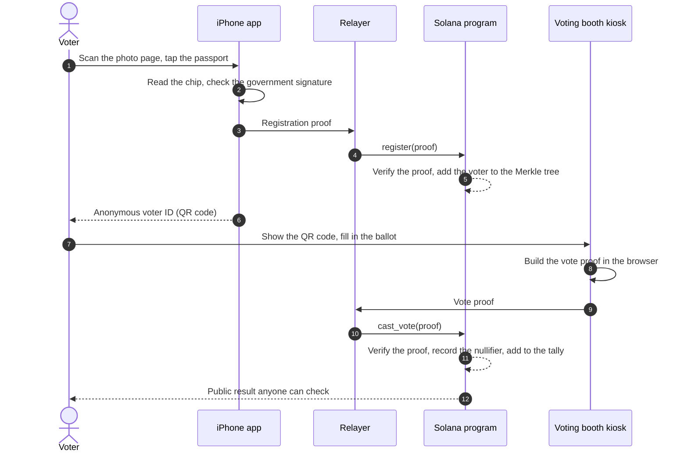

<div align="center">


# Votify

**Private. Verifiable. Secure.**

A privacy-preserving, publicly verifiable voting system built on Solana, using secure digital IDs and zero-knowledge proofs.

[Program on Solana Explorer](https://explorer.solana.com/address/AwcbfwxYwfcxyr5WWpws9PwjeSnvNwYVH6PnsEdgE82o?cluster=devnet)

**Contributors:** James Rivera, Artem Lavrentyev, Leo Nagakoshi

</div>

## Inspiration

More than half of Americans lack trust in the integrity of their elections.

In 2026, only 34% of Americans said they trust the government's certification of election results, down from 40% in 2024 ([AP-NORC](https://fortune.com/2026/09/09/americans-trust-federal-government-information-poll/)). Half of Americans think voter fraud is likely to occur in this year's elections ([NPR/PBS News/Marist](https://maristpoll.marist.edu/polls/election-security-march-2026/)).

With widespread misinformation about election results, voters are left frustrated and unsure whether their vote was counted. They need a way to verify the results themselves.

The problem is that voters are asked to trust the process with no way to check the results for themselves. Everything after you cast your ballot is a black box. And publishing every vote would jeopardize the privacy of every voter's ballot.

The future of our election systems needs to be:

- **Verifiable:** anyone can check the authenticity and integrity of the results for themselves.
- **Private:** voters can be confident their vote stays confidential, even from the people running the election.
- **Secure:** only authorized, eligible citizens can vote, each only once, and no one can change the results.

This made us ask ourselves: how can we build an election that is verifiable, private and secure, all at once?

## What Votify does

Votify is a privacy-preserving, publicly verifiable voting system built on Solana, using secure digital IDs and zero-knowledge proofs.

1. **Scan.** Scan your passport's photo page and tap the passport to your iPhone. The app reads the chip and checks the government signature. It then builds a zero-knowledge proof that you are an adult US citizen with an unexpired passport, and registers an anonymous voting credential on Solana. Your passport data never leaves your phone.
2. **Vote.** Show your voting QR code at the voting booth kiosk and fill in your ballot. The kiosk builds a second proof showing you're a registered voter, without revealing which one, and submits your vote.
3. **Verify.** A Solana program checks every proof, blocks double registration and double voting, and keeps a public tally. Anyone can watch the live results and re-check every transaction.

Nothing on chain links a vote to a registration or to a person.

## Security and privacy

Votify is built to protect personal information and strengthen trust in one of the most important systems we have: our elections.

**How Votify protects every vote**

- **Authenticity:** the passport's government signature is checked inside the zero-knowledge proof, so a forged or altered passport can't register.
- **Authorization:** only a valid proof of an adult US citizen can register, and only registered voters can cast a ballot.
- **Integrity:** Solana checks every vote's proof before it counts, blocks double votes, and keeps every transaction public, so no one can quietly change the results.
- **Confidentiality:** your name and passport details are never published, and nothing on chain links a vote to a person.

**How Votify protects personal information**

- **Your passport stays with you.** The app reads and checks the passport chip on your phone, and never stores or sends your passport data.
- **Prove, don't share.** The zero-knowledge proof shows you are an eligible voter while revealing nothing about who you are.
- **Your voter ID is locked to you.** It is kept in the iPhone's secure Keychain and only shown after Face ID.
- **No trail back to you.** A relayer pays every transaction fee, so no wallet or account is ever linked to a vote. It keeps no logs of who sent what, and the kiosk erases your voter ID from memory as soon as you finish.

## How it works



## How we built it

- **Zero-knowledge circuits:** written in Circom. They check the passport's government signature and prove you're an eligible voter without revealing who you are. We wrote our own RSA and SHA-256 code for this.
- **Solana program:** built with Anchor. It checks every proof, stores the list of registered voters, and counts the votes.
- **iPhone app:** built in SwiftUI. It scans your passport, reads its chip and checks it on the phone.
- **Relayer:** a Node server that pays the transaction fees, so voters never need a crypto wallet.
- **Voting booth kiosk:** a React web app that scans your QR code and builds your vote proof.

## Solana

We built Votify on Solana because it is the only blockchain that could support this project.

- **Speed:** Solana can process thousands of votes per second, and each one confirms in seconds, so the public tally updates live.
- **Low cost:** each vote costs about a thousandth of a SOL, paid by our relayer, never the voter.
- **Proofs on chain:** Solana's built-in cryptography lets our program verify each zero-knowledge proof inside a single transaction.
- **No double voting:** each vote creates a PDA from the voter's one-time nullifier. A second vote tries to create the same PDA, the addresses collide, and Solana rejects it.

Our program is deployed on Solana devnet at `AwcbfwxYwfcxyr5WWpws9PwjeSnvNwYVH6PnsEdgE82o` ([view on Solana Explorer](https://explorer.solana.com/address/AwcbfwxYwfcxyr5WWpws9PwjeSnvNwYVH6PnsEdgE82o?cluster=devnet)).

## What's next for Votify

- **Every voter, not just passport holders:** we'll accept any government-signed ID, including mobile driver's licenses in Apple Wallet and Google Wallet.
- **Built for the world:** Votify uses the same chip standard that e-passports follow worldwide, so we'll expand to elections across the globe, starting with citizens living abroad, many of whom must travel to an embassy or mail a paper ballot to vote.

## What is in this repo

| Folder | What it holds |
|---|---|
| `circuits/` | Registration and vote circuits, our RSA and SHA-256 gadgets, circuit tests |
| `programs/zk_election/` | Anchor program and Groth16 verifier |
| `packages/` | Shared TypeScript: constants, Merkle tree, proof format, passport parsing |
| `relayer/` | Fee-paying relayer and voter simulation |
| `web/` | Voting booth kiosk and live results |
| `ios/` | iPhone app and the PassportKit Swift package |
| `tools/` | Mock passports, key lists and verifying-key export |
| `tests/` | Program, relayer and end-to-end tests |

## Quickstart

### Prerequisites

- macOS with Xcode
- Node.js 22 or later
- Rust, the Solana CLI 4.1.2, Anchor 1.2.2 and Circom 2.2.3 (the setup script installs them)

### Setup

```bash
make setup
```

This installs the toolchain, builds the circuits with a local trusted setup and builds the program.

### Test

```bash
make test
```

```bash
make program:test
```

### Run the election

```bash
make demo:start
```

This starts the relayer against Solana devnet, opens a Cloudflare tunnel, deploys the kiosk and results pages, and registers 30 simulated voters. Stop it with `make demo:stop`.

### iPhone app

```bash
make ios:build
```

Open `ios/ZKElection.xcodeproj` in Xcode, set your team, and run on an iPhone with NFC.
